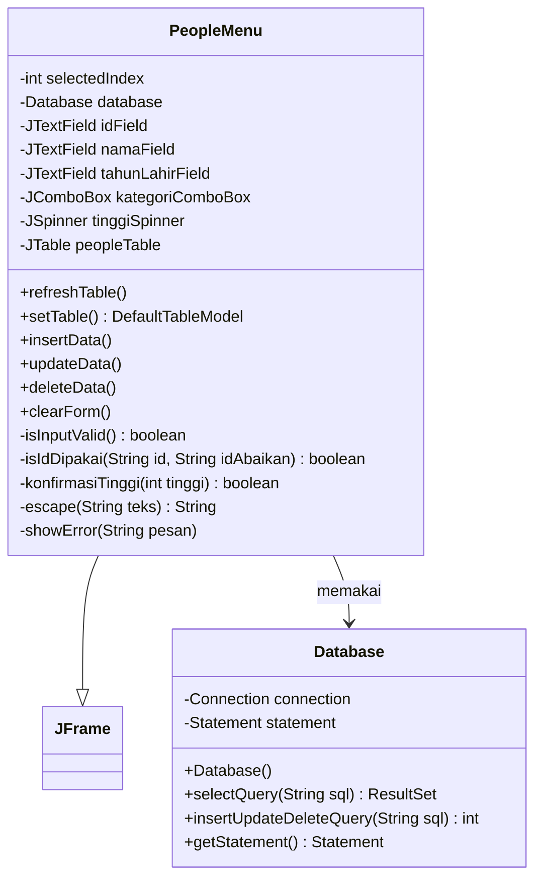
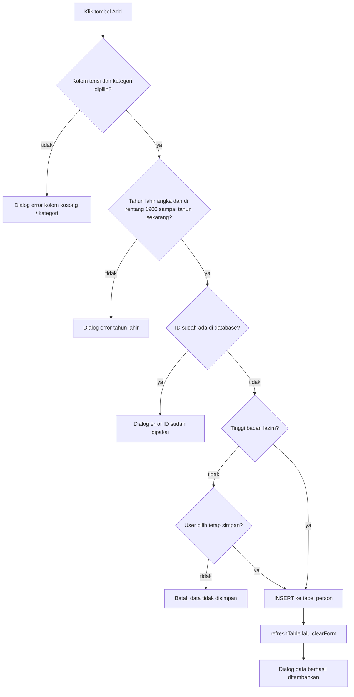
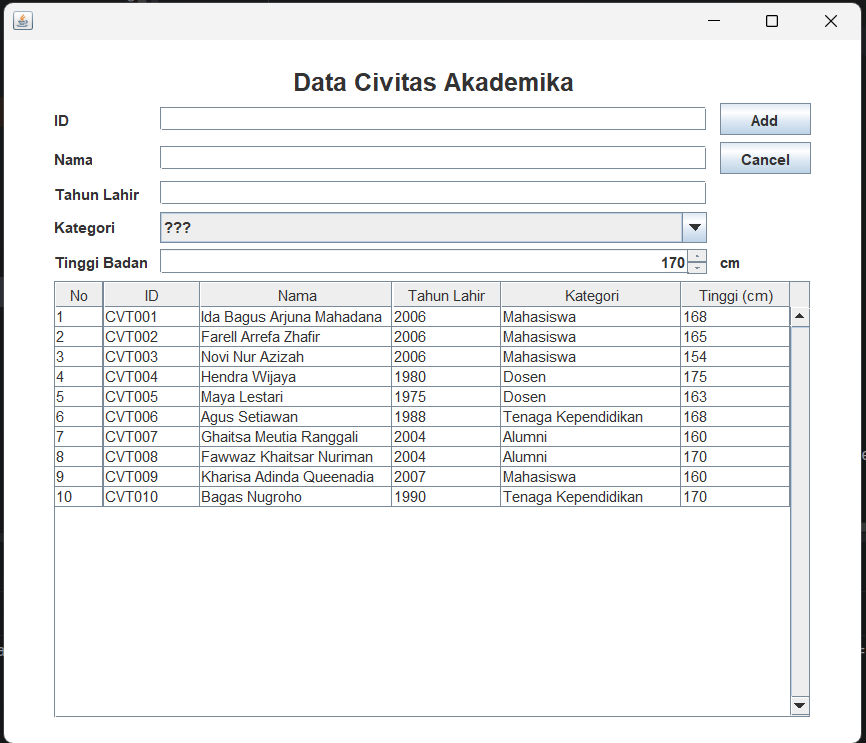
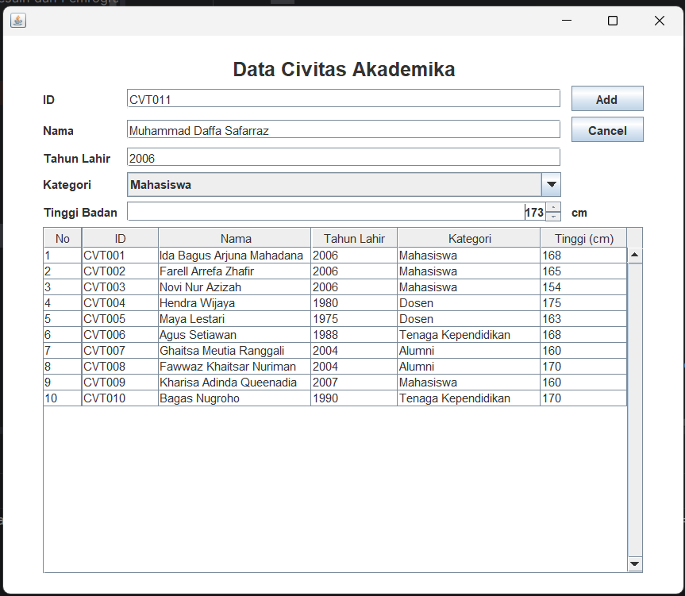
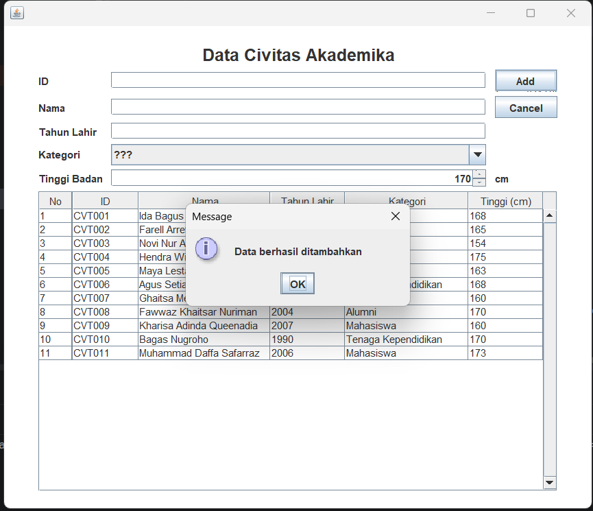
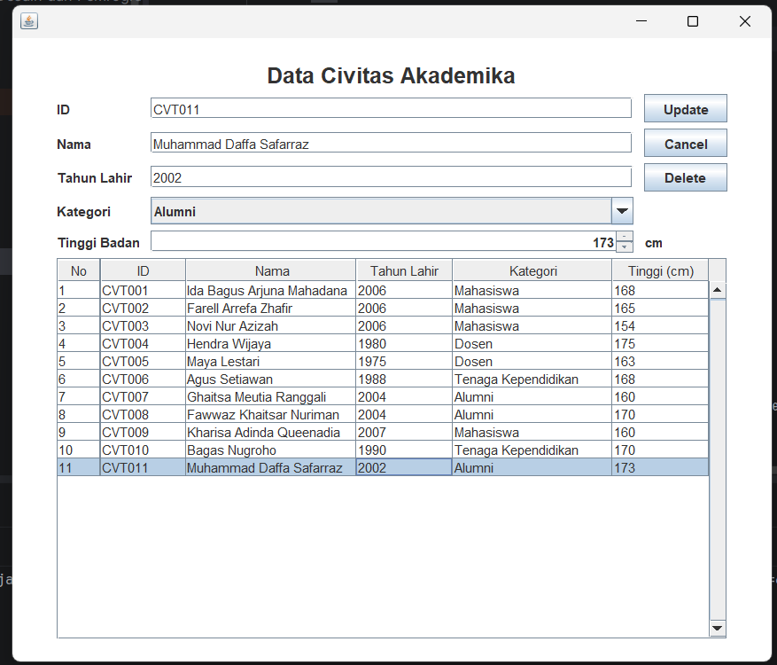
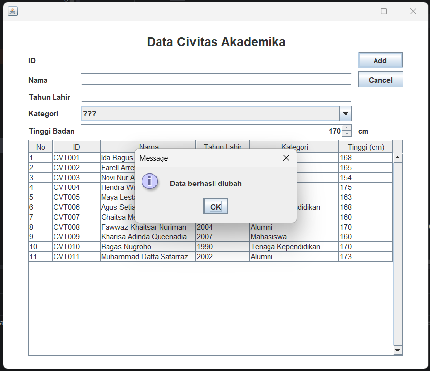
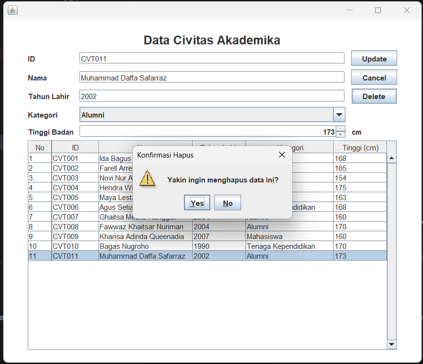
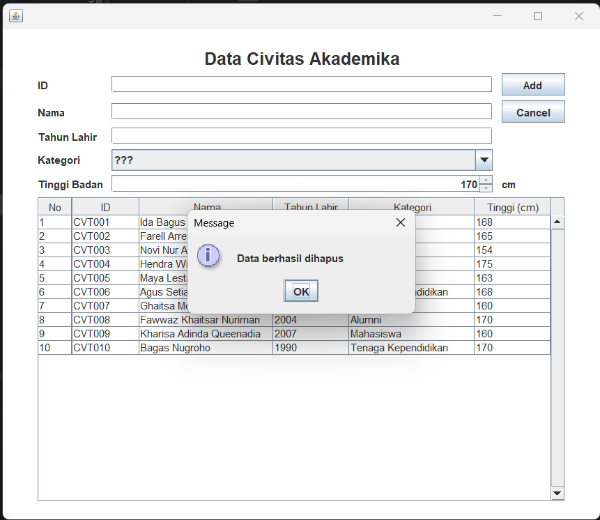
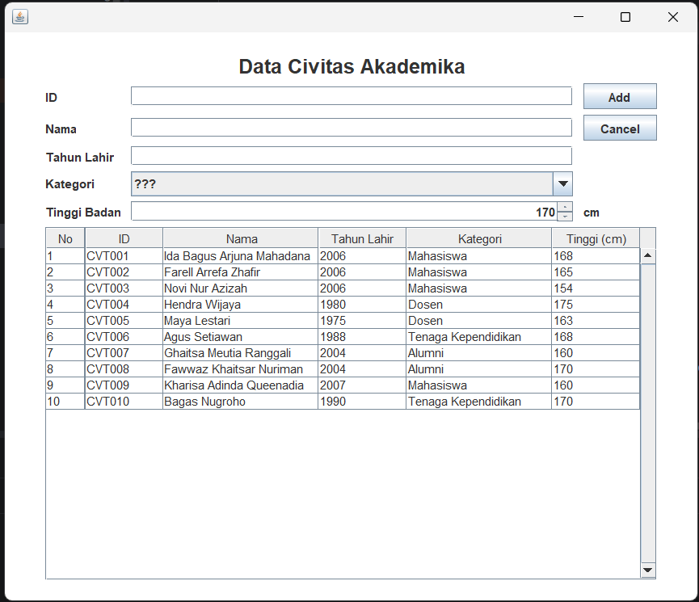

# TP5 DPBO

Saya Muhammad Fadey Rafif dengan NIM 2504792 mengerjakan Tugas Praktikum 5 dalam mata kuliah Desain dan Pemrograman Berorientasi Objek untuk keberkahanNya maka saya tidak melakukan kecurangan seperti yang telah dispesifikasikan. Aamiin.

## Struktur Folder

```text
TP5/
├── PeopleData/
│   └── src/
│       ├── Database.java
│       ├── PeopleMenu.java
│       ├── PeopleMenu.form
│       └── Person.java
├── dokumentasi/
└── Readme.md
```
## Desain Program

### Class Diagram



- `PeopleMenu` mengurus tampilan (form dan tabel) serta CRUD.
- `Database` khusus mengurus koneksi ke MySQL dan menjalankan query. `PeopleMenu` tidak menyentuh JDBC secara langsung, semua query lewat class ini.
- `Person` tidak dipakai lagi karena data sekarang dibaca langsung dari hasil query.

### Data yang digunakan

Aplikasi terhubung ke database `db_people` dan membaca tabel `person`. Kolom yang digunakan kode adalah `id`, `nama`, `thn_lahir`, `kategori`, dan `tinggi`.
### Tampilan Program

Form berisi input ID, Nama, Tahun Lahir, Kategori, dan Tinggi Badan, lalu ada tombol Add/Update, Delete, dan Cancel. Di bawahnya ada tabel yang menampilkan semua data dari database dengan kolom No, ID, Nama, Tahun Lahir, Kategori, dan Tinggi (cm).

## Penjelasan Alur

### Saat program dijalankan
1. Constructor `PeopleMenu` membuat objek `Database`, yang langsung membuka koneksi ke `db_people`.
2. `refreshTable()` memanggil `setTable()`, yang menjalankan `SELECT * FROM person` lalu memasukkan hasilnya ke tabel baris per baris. Kolom No dibuat dari nomor urut.

### Insert (tombol Add)


Cek ID kembar dilakukan dengan query `SELECT id FROM person WHERE id = ...`. Kalau hasilnya ada baris, berarti ID sudah dipakai.

### Memilih data (klik baris tabel)
1. Mouse listener menyimpan nomor baris yang diklik ke `selectedIndex`.
2. Nilai tiap kolom diambil dari model tabel lalu diisikan ke form.
3. Tombol Add berubah jadi Update dan tombol Delete ditampilkan.

### Update (tombol Update)
1. Validasi sama seperti insert (kolom kosong, kategori, tahun lahir, tinggi tidak lazim).
2. ID lama diambil dari baris tabel yang dipilih, karena ID di form bisa saja sudah diubah.
3. Cek ID kembar tetap dilakukan, dengan mengabaikan ID milik data yang sedang diubah.
4. Jalankan `UPDATE person SET ... WHERE id = <id lama>`, lalu tabel dimuat ulang dan form dibersihkan.

### Delete (tombol Delete)
1. Muncul dialog konfirmasi "Yakin ingin menghapus data ini?".
2. Jika Yes, ID diambil dari baris yang dipilih lalu dijalankan `DELETE FROM person WHERE id = ...`.
3. Tabel dimuat ulang dan form dibersihkan.

### Cancel
`clearForm()` mengosongkan form, mengembalikan tombol Update menjadi Add, menyembunyikan tombol Delete, dan menghapus pilihan baris di tabel.

### Dialog yang ada

| Kondisi | Jenis | Pesan |
|---|---|---|
| ID, Nama, atau Tahun Lahir kosong | Error | ID, Nama, dan Tahun Lahir tidak boleh kosong! |
| Kategori masih `???` | Error | Pilih kategori terlebih dahulu! |
| Tahun lahir bukan angka | Error | Tahun lahir harus berupa angka! |
| Tahun lahir di luar rentang | Error | Tahun lahir harus antara 1900 sampai tahun sekarang! |
| ID sudah ada saat insert (atau update ke ID milik data lain) | Error | ID sudah dipakai, gunakan ID lain! |
| Tinggi badan di bawah 30 atau di atas 300 cm | Konfirmasi | Tinggi ... cm tidak lazim. Tetap simpan? |
| Klik Delete | Konfirmasi | Yakin ingin menghapus data ini? |
| Insert, update, delete berhasil | Info | Data berhasil ditambahkan / diubah / dihapus |

## Dokumentasi

### 1. Tampilan awal 



### 2. Insert



### 3. Read



### 4. Update



### 5. Delete




### 6. Tampilan akhir

